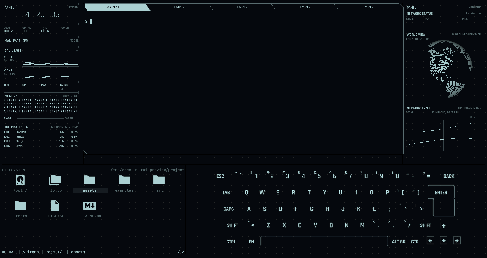
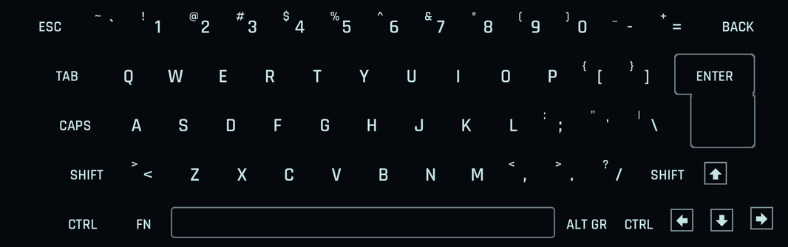

# eDEX-UI TUI

An eDEX-UI reconstruction for Linux terminals, using Kitty graphics and tmux.



Omarchy VM preview with the optional keyboard open.

I’m a TRON fan, and I remember how exciting eDEX-UI felt when it first appeared. After spending a few months with Omarchy, I wanted to bring that interface into the terminal. I built this prototype with AI assistance and existing tools, and I’m opening it up for feedback and collaboration. I’m a student with some programming experience; I’m still learning UI design.

Each section occupies a tmux pane. You get native shells in the center, system and network instruments on the sides, and a Yazi file browser below. You can summon the keyboard when you need it and keep the space for files when you don’t.

I use [the security-patched eDEX-UI fork](https://github.com/theelderemo/eDEX-UI-security-patched) as the reference, pinned in [UPSTREAM.json](UPSTREAM.json). GitSquared and the [original eDEX-UI contributors](https://github.com/GitSquared/edex-ui) deserve the credit for the interface, artwork, and animation direction. This is an independent project with no affiliation to those maintainers or Disney.

## What works

- System and network panes with live Linux counters, CPU and traffic history, the original globe mesh, and memory grid. Unknown endpoint and location data stays unknown.
- Five clickable shell tabs. Switching preserves the shell processes and working directories; unused slots start on demand.
- Yazi file navigation with the upstream SVG icons and a grid navigation model.
- An optional keyboard with the upstream layout, shifted legends, arrow artwork, and tap feedback. It starts hidden and sends input to the selected central shell.
- An upstream-derived startup sequence. The instruments target 24 FPS through lossless compressed RGB updates.



This image shows the keyboard renderer. See [validation](docs/VALIDATION.md) for the scope of desktop testing. We have not established a performance advantage over the Electron application.

## Run

Use Linux with Kitty graphics support. We reviewed the current interface in a disposable Omarchy VM with Kitty 0.49.2, tmux 3.8, Yazi 26.9.1, Python 3.14, and Pillow 12.3. An earlier prototype ran on Ubuntu; we still need to retest the current interface there.

On Arch or Omarchy:

```sh
sudo pacman -S --needed kitty tmux python-pillow yazi librsvg ttf-dejavu
git clone https://github.com/ChromedomeV12/edex-ui-tui.git
cd edex-ui-tui
kitty --config "$PWD/kitty.conf" python3 "$PWD/launch.py" --cwd "$HOME"
```

Launch outside an existing tmux session. Allow at least 140 columns by 40 rows. The launcher uses its own `edex-terminal-<uid>` socket and project configs; you keep your normal tmux and Yazi settings. Older Yazi releases may use incompatible Lua APIs. Native Windows terminals and nested tmux are outside the tested setup.

| Control | Action |
| --- | --- |
| Click a tab / Ctrl-b then 1–5 | Switch shell |
| Ctrl-b then Shift-K | Show or hide the keyboard |
| Ctrl-b then an arrow | Move focus between panes |
| Ctrl-b then z | Zoom or restore a pane |
| Ctrl-b then d | Detach; leave the session running |

From another terminal in the checkout:

```sh
python3 launch.py --toggle-keyboard
# Stop this project's session, including its shells:
python3 launch.py --stop
```

Use `--skip-intro` to skip startup. `--files auto|yazi|superfile|preview` selects navigation; the custom icon grid needs Yazi and librsvg. For other Python environments, install [requirements.txt](requirements.txt) in a virtual environment. Supply your own licensed fonts with `--display-font` and `--light-font`; we bundle Rajdhani under the OFL.

## File navigation

Click the file pane first. The caption highlight tracks your current card; `*` means a file belongs to a batch selection.

| Control | Action |
| --- | --- |
| Arrows | Move through the grid; up/down move a row |
| Enter | Enter the highlighted folder or open the highlighted file |
| Backspace / h | Go up one folder |
| l | Enter the highlighted folder |
| Click or tap a card | Highlight it |
| Mouse wheel / j / k | Move by rows |
| Page Up / Page Down | Move one grid page |
| Home / g g, End / G | First or last file |
| Root / and Go up cards | Click the first-page navigation shortcuts |
| g /, g h | Go to root or home |
| g then Space | Type a directory path |
| Space | Mark or unmark, then advance |
| f | Filter names; Enter accepts, Escape clears |
| . | Toggle hidden files |
| o / O | Open marked files / choose an opener |
| y / x, then p | Copy / cut, then paste |
| r / a | Rename / create a file; end a name in / for a folder |
| ~ / F1 | Show Yazi’s key guide |

The browser keeps its own directory. It does not change shell directories. The on-screen keyboard targets the central shell; use a physical keyboard, client keyboard, or mouse in Yazi. We disable drag-and-drop because Yazi’s native drag targeting assumes list rows. Read the [file guide](docs/FILE-NAVIGATION.md) for selection and small-pane behavior.

## What needs work

Read the [interface roadmap](docs/INTERFACE-ROADMAP.md) for the upstream dotted background, pop-out detail views, and border integration plan.

The normal layout still uses tmux borders without eDEX’s clipped corners. The `experiment/kitty-borders` branch has a standalone one-shell prototype using Kitty relative placements and upstream-derived contours. See the [border experiment](docs/BORDER-EXPERIMENT.md) for commands, measurements, and limits. Main retains the reviewed interface.

Rajdhani approximates the upstream typography. We do not distribute United Sans or claim an exact movie-font match. We also have gaps in startup choreography, audio, and other upstream effects.

Physical typing does not light up the on-screen keyboard yet. We have tested synthetic mouse taps through tmux, but not a physical tablet. Tablet SSH clients need Kitty graphics, Unicode placeholders, and mouse events; we have not verified a compatible iOS or Android setup, or graphics transport through Mosh. See [keyboard behavior and tests](docs/KEYBOARD.md).

We still need broader resize, reattach, and multiple-client testing. CPU rasterization has a cost. Please include your terminal version, tmux version, and reproduction steps when reporting rendering problems.

## Contribute

Read [CONTRIBUTING.md](CONTRIBUTING.md) for the layout, test commands, and review expectations. Keep private paths, credentials, and typed shell contents out of reports and screenshots. Read [SECURITY.md](SECURITY.md) before reporting a vulnerability.

We distribute the port under GNU GPL version 3. Read [LICENSE](LICENSE) for the terms and [NOTICE.md](NOTICE.md) for upstream and font credits.
